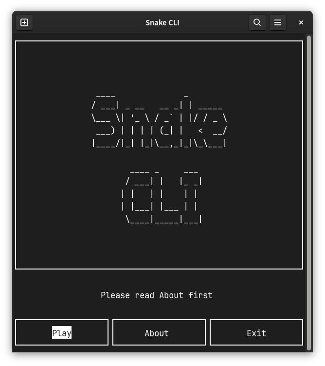
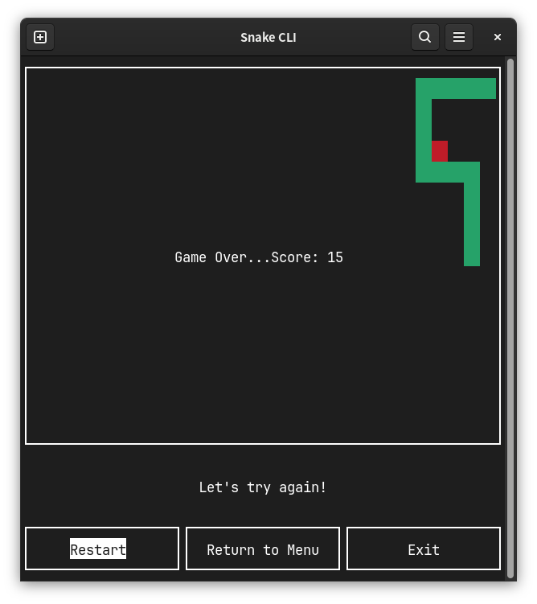

# Snake CLI（终端贪吃蛇）

这是我自己编写的终端贪吃蛇游戏。C23 + ncurses，POSIX 平台。

推荐使用GNU/Linux或macOS构建运行。

## 游戏截图





## 特性

- 色块渲染：蛇与苹果为实心色块，使用终端调色板语义色，自动适配终端主题
- 正方形格子：双列渲染，横竖方向速度与粗细一致
- 终端环境检查：启动时检查颜色支持与终端尺寸，不满足时给出提示并等待调整
- `-C` / `--check` 参数：实时检查终端尺寸，帮助你找到最佳宽度

## 操作

- 方向键 / WASD：移动蛇；左右方向键切换菜单选项
- Enter：确认
- ESC：暂停游戏 / 退出 About 页

## 构建与运行

依赖：ncurses、CMake ≥ 4.3、支持 C23 的编译器。

> 终端需支持颜色，至少 35×23（宽×高），且列数为偶数；不满足时游戏会在启动时提示并等待调整。注意：Linux TTY 等无法调整大小的终端，若列数为奇数则无法游玩。

```sh
cmake -B build
cmake --build build
./build/snakecli
```

## 文件结构

```
main.c           看门狗进程（fork / waitpid / 终端修复）
game.c           ncurses 初始化、环境门、SIGWINCH 处理、顶层状态机
menu.c           主菜单（Play / About / Exit，含 Logo 与 About 绘制）
play.c           游戏本体（内部状态机、移动、苹果、渲染与输入）
utils.c          通用辅助（命令行参数、居中打印、选项窗）
game.h / utils.h 共享数据结构与声明
```

---
本项目使用GPL v3协议开源
